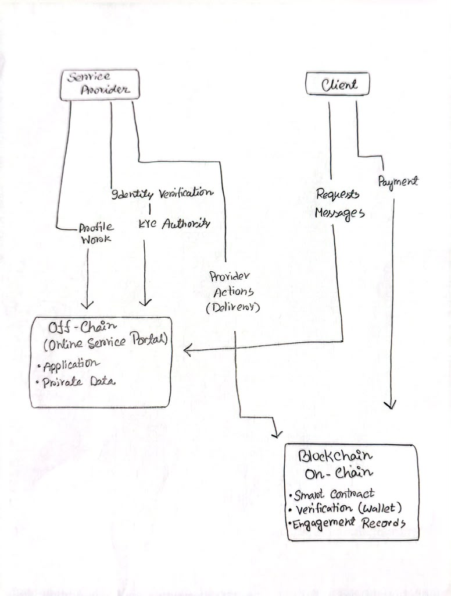

# ServicePortal — Checkpoint Report

Cumulative report, maintained across checkpoints. This snapshot: **Checkpoint 2 — On Chain**.

| Field | Value |
| --- | --- |
| Project | ServicePortal (Team MS) |
| Team | Sadia Alam and Maisha Islam |
| Network | DIDLab, chain ID 252501 |
| Repository | https://github.com/Mai1sha/Blockchain-project |
| Official team deployment URL | https://teamms.didlab.org |
| Individual test deployment (Lab 1) | https://maisha.didlab.org |
| Graded Git commit | The commit tagged `cp2` (full hash submitted on Canvas) |

---

## 1. Project Identity

ServicePortal is a blockchain-assisted online marketplace for professional services such as tutoring, design, writing, and development. Sensitive marketplace content stays off chain; provider credentials, engagement state, and escrow payments are recorded on chain so that they can be verified independently.

| Member | Role |
| --- | --- |
| Sadia Alam | ProviderVerify contract and tests; DIDLab live reads, wallet connection and provider-verification frontend; team site |
| Maisha Islam | EngagementEscrow contract and tests; deployment scripts and manifest; escrow frontend (status panel and create-engagement form); DIDLab hosting setup |
| Both | Planning, design decisions, and documentation |

Team charter: repository owner Maisha Islam; DIDLab operator Sadia Alam; evidence keeper both (see `docs/TEAM_CHARTER.md`).

## 2. Problem, Stakeholders, and Trust Boundaries

### Problem statement

Online professional-service platforms connect clients with independent tutors, designers, writers, developers, consultants, and other digital professionals. These parties may have no previous relationship and must rely heavily on the platform operator to establish the identity and legitimacy of service providers and maintain the authoritative history of their engagements. A client needs assurance that a provider has passed the platform's required verification process. Both parties also need reliable evidence of whether an engagement was accepted, work was submitted, the client accepted the delivery, and the engagement was completed. They must also trust the platform to manage payments fairly, ensuring that providers are paid for accepted work while clients' funds are protected until agreed conditions are met.

In conventional platforms, these trust-critical records and payment processes are controlled by the platform's private infrastructure. Participants and external verifiers cannot independently verify historical actions without relying on the platform operator, while sensitive identity information, communications, and professional work must remain private. This dependency makes independent verification difficult when disputes occur or when records need to be checked outside the platform.

### Stakeholder, asset, and transaction map (retained from Checkpoint 1)

| Element | Answer |
| --- | --- |
| 1. Stakeholder | Clients, service providers, platform operators, identity-verification (KYC) providers, payment processors, platform support, and external verifiers. A client requests services, receives work and approves delivery. Service providers create professional profiles, accept engagements and submit work. The platform operator manages accounts, profiles, messaging, files, reviews and more. The identity-verification provider examines identity evidence and reports whether a provider passed verification. The payment processor processes payments and refunds. Platform support investigates disagreements between clients and providers. External verifiers may need to confirm whether a provider was verified or whether an engagement event occurred. |
| 2. Asset | Provider identities and verification status, profiles, skills, service listings, proposals, agreements, messages, submitted work, delivery approvals, reviews, payment records, and engagement history. |
| 3. Transaction | A provider creates a profile and completes identity verification. A client finds a provider and sends a service request. The provider accepts or declines it. They communicate, and the client pays. The provider submits the work, and the client accepts it. Either party can cancel or open a dispute. After completion, the client can leave a review, and a payment is processed. |
| 4. Records | The platform records profiles, listings, engagement statuses, reviews and uploaded deliverables in its private databases and file-storage systems. The KYC provider stores identity documents and verification results in its private systems. |
| 5. Intermediary | The professional-services platform is the principal intermediary because it controls user accounts, provider profiles and the authoritative engagement history. The KYC company acts as the identity-verification intermediary, alongside one payment intermediary. Clients and providers must look to these organizations' records when verifying what happened. |
| 6. What goes wrong | A client may not be able to independently confirm that a provider completed verification. The platform can change, remove or lose engagement records. One party may deny accepting an engagement, submitting work or approving delivery. Records stored by the platform, KYC provider and payment processor may conflict or be difficult to combine. Dispute resolution may be slow because participants depend on the platform's private records. Fraudulent profiles, false qualifications, and disagreements about delivery or acceptance may cause financial loss and reduced trust. |

### Trust-boundary diagram

## 3. Blockchain Suitability Verdict

### Qualifiers (Checkpoint 1 baseline)

| # | Question | Answer | Justification |
| --- | --- | --- | --- |
| Q1 | Multiple parties who do not fully trust each other act on the same data | Yes | Clients, service providers, and the verification authority interact with trust-critical information related to provider verification and service engagements. Clients and providers may not trust each other's claims about engagement acceptance, delivery, completion, or payment. Both need a consistent record of engagement and payment state. |
| Q2 | Multiple parties need to write, not only read | Yes | The verification authority records provider verification; the client creates and funds an engagement and accepts delivery; the provider accepts the engagement and attests that work has been delivered. No single party records the entire history. |
| Q3 | A trusted intermediary's cost, delay, failure risk, or power is itself the problem | Yes | The platform operator normally holds the authoritative records of verification, engagement status, and payment activity, which makes it a central point of control and dependence. |
| Q4 | Someone must verify a claim without trusting the claimant | Yes | Clients need to verify that a provider completed verification without relying on the provider's own claim; an independent verifier may need to check verification status and engagement actions without access to the platform's database. |
| Q5 | The record must remain tamper-evident after the fact | Yes | Verification status, engagement creation, acceptance, delivery attestation, client acceptance, completion and payment state may be needed later in a dispute, so neither a participant nor the operator should be able to silently alter them. |

### Disqualifiers (Checkpoint 1 baseline)

| # | Disqualifier | Applies? | How the design handles it |
| --- | --- | --- | --- |
| D1 | Requires confidential content readable on chain | No | Only wallet addresses, verification status, engagement state, state-transition events, commitments, and escrow/payment state are on chain. |
| D2 | Requires throughput or finality beyond ~2 s blocks | No | Transactions occur only at lifecycle events (verification, creation/funding, acceptance, delivery, completion, settlement). |
| D3 | Requires large data on chain | No | Deliverables, documents and other large data stay off chain; only state and hashes are recorded. |
| D4 | All critical facts enter through a single unverifiable reporter | No | Different authorized parties make different state changes, and each transaction identifies the wallet that authorized it. The chain proves that an authorized party made a claim, not that an off-chain fact (a KYC decision, work quality) is true. |
| D5 | Business process requires reversible or erasable records | No | Changes such as credential suspension or revocation are new state transitions; earlier history is preserved. |

### Verdict and independently verifiable claim

The project passes all qualifiers and no disqualifier applies. It is suitable because multiple independent parties perform trust-critical actions — provider verification, engagement creation and funding, provider acceptance, delivery attestation, client acceptance, and payment settlement. Blockchain is used only for provider-verification status, engagement lifecycle records, and escrow/payment state.

**Verifier check:** a third party with no access to any participant's private systems can verify a provider wallet's recorded verification status, and the lifecycle and payment state of an engagement, by inspecting contract state, transactions, and events on chain 252501.

## 4. Architecture — Components and Trust Boundaries

| Layer | Components and data flow | CP2 status |
| --- | --- | --- |
| Browser / Next.js ServicePortal | MetaMask → DIDLab chain 252501. Read path: RPC → `ProviderVerify.isVerifiedProvider` and `EngagementEscrow.lastEngagementId` / `getEngagement` → rendered status. Write paths: verifier wallet → `ProviderVerify.verifyProvider`; client wallet → `EngagementEscrow.createEngagement` → `EngagementCreated` event → panel refresh. | Live at https://teamms.didlab.org with provider and escrow features together |
| DIDLab smart contracts | `ProviderVerify.sol`; `EngagementEscrow.sol` (checks ProviderVerify through `IProviderRegistry`) | Both deployed (§6) |
| Hosting | Next.js static export served from `/srv/www`; Express server (`frontend/server.js`, bound to `process.env.PORT`) in `/srv/app` | Live |
| Off-chain platform | KYC documents, profiles, messages, specifications, deliverables | Planned; not claimed live |

| Contract | What is implemented |
| --- | --- |
| ProviderVerify.sol | An authorized `VERIFIER_ROLE` can verify providers; supports expiry, suspension, reinstatement and revocation, public status reads, custom errors, and events. Role-based permissions protect every state change. It records an authorized attestation, not identity documents or proof of real-world identity. |
| EngagementEscrow.sol | Holds TRUST in escrow and records engagement creation/funding, provider acceptance or decline, delivery commitment, client approval, completion, cancellation, refunds, and pull-based withdrawals. Checks provider eligibility through the registry interface; uses state and role checks, custom errors, events, and reentrancy protection. |

**Changes from the CP1 design:** the proposal sketched a Boolean provider-status mapping and a simpler engagement lifecycle. The implemented registry adds roles, expiry, suspension and revocation; the escrow adds funded settlement with refunds and timeouts. The trust boundary is unchanged (§15).

## 5. On-Chain / Off-Chain Data Decisions

| Data / record | On chain | Off chain | Justification |
| --- | :---: | :---: | --- |
| KYC / identity information | | ✓ | Sensitive personal information; not needed for public verification. |
| Provider profile, skills, listings | | ✓ | Ordinary marketplace data that changes often. |
| Provider verification status | ✓ | | Lets anyone verify that a wallet holds valid provider status. |
| Engagement ID and state | ✓ | | Identifies the engagement without exposing job details. |
| Client / provider wallets | ✓ | | Identify and authorize the actors of each engagement action. |
| Service specification | hash only | ✓ | Only `keccak256` of the description is stored as `specHash`; the text stays off chain. |
| Requirements, proposals, reviews | | ✓ | Private communications and application data; not needed for contract execution. |
| Digital deliverables | hash only | ✓ | Large, confidential work; only a deliverable hash is attested on chain. |
| Escrow amount / payment state | ✓ | | Required for escrow and independently verifiable settlement. |

**CP2 implementation note:** the contracts hold wallet addresses, verification and payment state, and commitments. They store no names, emails, KYC documents, messages, or deliverable content. Spec and deliverable hashes must not be computed from personal identifiers; the create form warns users not to enter personal information. Off-chain file storage and retrieval are not yet claimed as implemented.

## 6. Deployment Record

| Network | Value |
| --- | --- |
| Chain ID | 252501 |
| RPC | https://eth.didlab.org |
| Explorer | https://explorer.didlab.org |

| Field | ProviderVerify | EngagementEscrow |
| --- | --- | --- |
| Contract address | `0x74483FA46Fc8ee453E0fE03485254dB6D24B1080` | `0x3fbeE1dBC1929620cAcdcc3C0DA4F2B60f473C88` |
| Deployment transaction | `0x47c0ce3d4f697c4d67a7579bc7fc9f70e7bd37ccceb09e6add87707a465e5745` | `0x39ff8edfe087d5f57a4eb5a44bf948042f19c7ca021a71b9583e4307fbf2d194` |
| Block | 6681710 | 6682519 |
| Gas used | 1,140,503 | 1,241,796 |
| Deployer | `0x8Cd7F85acC2c2D5bc69b448d09DB06664ef4e121` | `0xAEA4eF37a02A3Db6E2D8D71c68e3941064c59EC1` |
| Block time (UTC) | 2026-10-26T07:15:35Z | 2026-10-26T07:42:33Z |
| Status | Success | Success |

- **Manifest:** `deployments/didlab-252501.json` records the escrow deployment, its deployer, the administrator `0x8Cd7…e121`, and that ProviderVerify was reused rather than redeployed.
- **Scripts in Git:** `scripts/check-network.js`, `scripts/deploy-provider-verify.js`, `scripts/deploy.js`.

### Project transactions

| Transaction | Hash | Block | Gas | Status | What it proves |
| --- | --- | --- | --- | --- | --- |
| Provider verification | `0x41b2949577d89a3b20450989a1cc93d99898a24255bd3dba6bf21b5c515a0643` | 6707141 | 49,294 | Success | An authorized verifier recorded provider `0xAEA4…9EC1` as verified (`ProviderVerified`, topic0 `0xd989a2af…66d4333`). |
| Unauthorized verification | `0xfb6fcf03378307c8768be36cb2061eef9107bb5b949118ccc47f837d61d0829e` | 6710215 | 25,097 | Reverted | A wallet without `VERIFIER_ROLE` cannot verify a provider. |
| Engagement #1 created | `0x04f4938182ed32ab9204b28e9bcc34ebea851d5a3e7cb546cb1adae53f9d0e71` | 6724639 | 164,893 | Success | A client locked 0.01 TRUST for the verified provider (`EngagementCreated`). |
| Engagement to unverified provider | `0x0eeaafcd0daf2c19d77b7e11c2ba183cb1ee88ddf81fd8d43ee4c931be60af17` | 6725076 | 28,564 | Reverted | Escrow refuses an unverified provider; no event, no state change. |
| Engagement #4 created | `0x33a339085565134554b23ec42602201a9ed6af52a9055d65e3066596d6b01cd0` | 6725409 | 147,793 | Success | Pending → confirmed flow captured in the frontend. |
| Engagement #5 created | `0x3a66076c55b0e21e1ff11011055982ad77d163529ce682afb44ac278e7a9e297` | 6727514 | 147,793 | Success | Created from the deployed site, end to end. |

Full records with timestamps: `docs/evidence/CP2_serviceportal_evidence.md`.

## 7. Features Completed, With Evidence

| Feature | CP2 status | Evidence / location |
| --- | --- | --- |
| ProviderVerify: roles, expiry, suspension, revocation | Implemented and deployed | `contracts/ProviderVerify.sol`; §6, §8 |
| EngagementEscrow lifecycle and registry integration | Implemented, tested, deployed | `contracts/EngagementEscrow.sol`; 28 tests; §6 |
| Live chain read with no wallet | Working | `BlockchainStatus.tsx` shows chain ID 252501 and the latest block |
| Provider status live read | Working | Browser → RPC → `isVerifiedProvider(address)` → Verified / Not verified |
| Wallet connect and network detection | Working | `WalletConnect.tsx`; wrong network is reported and the create button stays disabled until a wallet is connected |
| Contract addresses shown on site | Working | Both addresses rendered on the page |
| Provider verification transaction | Working | Tx `0x41b2…0643` (§6) |
| Escrow status panel | Working | `EngagementStatus.tsx` reads `lastEngagementId` / `getEngagement` and refreshes on `EngagementCreated` |
| Create engagement (client write) | Working | `CreateEngagementForm.tsx`; engagements #1–#5 (§6) |
| Transaction states | Working | Pending, confirmed, user-rejected, simulation revert (`ProviderNotVerified`, `InvalidParties`), on-chain revert — screenshots in `docs/evidence/lab1_*` |
| Unified team-domain frontend | Yes | Provider + escrow features in one Next.js app, live at https://teamms.didlab.org as of 2026-11-10 (§13) |
| Provider accept / deliver / client accept / withdraw in the UI | Not yet | Contract functions exist and are tested; UI planned for CP3 |

**Read path:** a visitor opens the site, which calls DIDLab RPC and reads `ProviderVerify.isVerifiedProvider(provider)` and `EngagementEscrow.getEngagement(lastEngagementId)` on chain 252501, then renders the result. Nothing is hardcoded; the escrow panel changes only when the chain emits `EngagementCreated`.

## 8. Testing Evidence

Command: `npx hardhat test` — **44 passing** (re-run 2026-11-08). Screenshot: `docs/evidence/CP2_tests.png`.

| Suite | Passing | Key coverage |
| --- | ---: | --- |
| ProviderVerify | 12 | Admin/verifier roles, verification, unauthorized caller, zero address, invalid expiry, expiry, suspension, reinstatement, revocation |
| EngagementEscrow | 28 | Happy path paid exactly once, invalid inputs, unauthorized roles, wrong-state actions, cancellation/refunds, verification gating, deadlines, reentrancy, balance conservation |
| ProjectAnchor | 4 | Owner, event, non-owner rejection, empty commitment |
| **Total** | **44** | Both required failure classes |

Required failure assertions:

1. **Unauthorized caller:** ProviderVerify rejects verification and revocation by accounts without the right role; escrow tests restrict each action to the client or provider.
2. **Invalid input:** ProviderVerify rejects the zero address and invalid expiry; escrow rejects zero value, zero addresses, `client == provider`, zero hashes, unverified providers, and periods outside 1 hour – 180 days.

## 9. Security and Privacy Review

Due at Checkpoint 3. Controls already in place: role-based access, input validation, state checks, reentrancy protection with pull payments, simulation before every send, and no personal identifiers in on-chain fields.

## 10. Performance Measurements

Due at Checkpoint 3. Gas per operation will be measured from receipts during complete workflows, together with confirmation latency; estimates will not be substituted. Gas already observed: provider verification 49,294; engagement creation 147,793–164,893.

## 11. AI Development Record

Full record: `AI_RECORD.md`.

| Field | Entry |
| --- | --- |
| Tools | ChatGPT/Codex, Claude (Claude Code) |
| What we asked for | M1: requirement breakdown, DIDLab verification steps, wording for the suitability verdict, Markdown formatting and Git help. CP2: first drafts of the escrow frontend components, the Express hosting server, and step-by-step DIDLab deployment guidance; review of this report against the rubric and the chain. |
| How we verified it | Contracts compiled and 44 tests run locally; every frontend outcome tested in our own browser and wallet; every hash in this report re-checked against `eth.didlab.org`. |
| What it got wrong | M1: wrong proposal file placement (restored from Git history). CP2: MetaMask rejections first showed as failures (viem nests the 4001 error); it predicted `ProviderNotVerified` where the contract returns `InvalidParties` first; hosting needed `index.js` and `/srv/www`, found from the panel logs. |

AI never handled a private key; all transactions were approved by a team member in MetaMask.

## 12. Individual Contributions

Commits since Checkpoint 1 (from 2026-10-05, `git log`): **Maisha Islam 10**, **Sadia Alam 8** (6 as `S2adia`, 2 as `Sadia Alam`).

| Member | Checkpoint 2 contributions | Key commits |
| --- | --- | --- |
| Sadia Alam | ProviderVerify and its 12 tests; live DIDLab chain reads, MetaMask connection, provider-verification UI, frontend build fixes; static team site | `6092fd2`, `59f1b6c`, `dbcbb11`, `e063820`, `e94f960` |
| Maisha Islam | EngagementEscrow and its 28 tests; deploy script and manifest; escrow deployment; escrow status panel and create form; Express server and DIDLab hosting | `cd38a9c`, `0d88940`, `df67300`, `59708f3`, `ebbfea1`, `15b294d` |

## 13. Risks, Blockers, and What Went Wrong

| Risk / blocker | Description |
| --- | --- |
| Team domain was behind (resolved) | Until at least 2026-11-08, https://teamms.didlab.org still served the static CP1 project page, with no wallet connection or contract reads; the integrated build was only on https://maisha.didlab.org. It was redeployed by 2026-11-10 by uploading the build to `/srv/www`. The cause was that the two of us deployed separately, with no shared deploy step. The steps are now in the README. |
| Escrow UI incomplete | Only `createEngagement` has a UI. Accept, deliver, approve and withdraw exist in the contract and tests but not in the frontend. |
| Hosting surprises | DIDLab starts `/srv/app/index.js` (not `server.js`) and serves the root from `/srv/www`; the app crashed until both were found from the logs. These steps still need to go into the README for whoever redeploys. |
| Off-chain trust | KYC remains dependent on the authorized verifier. The chain records who attested, not whether the identity evidence is true. |
| Privacy and hash discipline | No personal identifiers may appear on chain, including hashes of them. Users type the service description, so the form warns against personal information. |

## 14. Plan for the Next Checkpoint

Checkpoint 3 — functional end-to-end use by someone outside the team.

1. Keep the team domain as the single deployment, and redeploy it from the README steps after every frontend change.
2. Add provider accept, deliver, client approve and withdraw to the UI; demonstrate a full engagement with on-chain evidence.
3. Exercise cancellation/refund, wrong network, no wallet, user rejection, and revert paths from a clean browser profile.
4. Security and privacy review covering at least three vulnerability classes against our own code.
5. Measure gas per operation and confirmation latency from real transactions.
6. Extend tests to new features and keep this report and the evidence file current.

**Original scope commitment (CP1):** wallet connection, provider verification, engagement creation and acceptance, delivery and completion state, and contract tests are the minimum viable features. Profiles, messaging, reviews and private file workflows are target features, not claimed.

## 15. Change Log — Checkpoint 1 to Checkpoint 2

| # | Change since CP1 | Reason / impact |
| --- | --- | --- |
| 1 | ProviderVerify grew from a status sketch into a role-controlled registry with expiry, suspension and revocation | Real credential lifecycle with authorized transitions |
| 2 | Implemented EngagementEscrow against the registry interface | Escrow only with eligible, verified providers |
| 3 | Deployed both contracts to chain 252501 | Planned state is now verifiable |
| 4 | Next.js live reads, wallet connection and network detection | Real browser → RPC → contract → UI path |
| 5 | Provider-verification transactions with event-based refresh | Contract writes with observable state change |
| 6 | Escrow status panel and create-engagement form, merged into the same Next.js app | Second core feature; client can fund an engagement from the browser |
| 7 | All four transaction outcomes handled and evidenced | Users see pending, confirmed, rejected and reverted states; display changes only from events |
| 8 | Express server and DIDLab hosting setup (`frontend/`) | Reproducible deployment |
| 9 | 44 passing tests | Authorized and unauthorized paths, invalid inputs, deadlines, refunds, reentrancy |
| 10 | Deployment scripts and manifest committed | Reproducibility and auditability |
| 11 | Team domain redeployed with the integrated build (by 2026-11-10); README updated with addresses, env vars and hosting steps | The graded URL now shows the working DApp, and someone else can rebuild it |

**Scope honesty:** both contracts are deployed and both core features have working frontends, and both are live on the team domain. The team domain was updated late (by 2026-11-10; see §13), and the later escrow steps have no UI yet. The privacy boundary and marketplace problem are unchanged from CP1.
